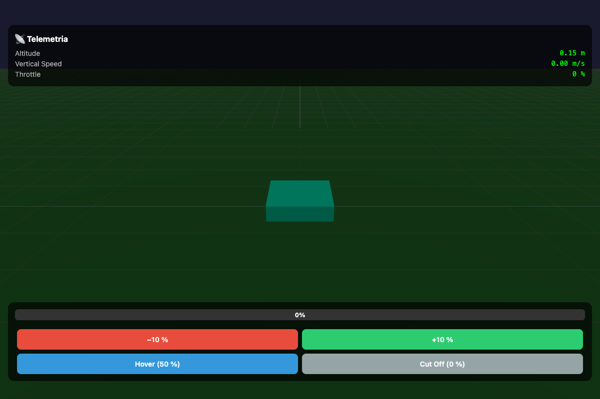
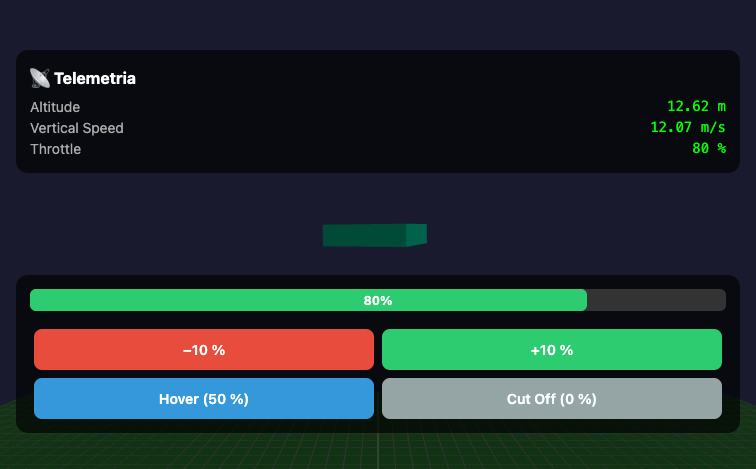
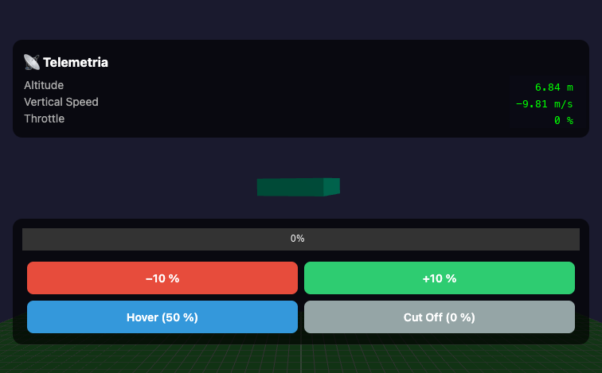

<!-- Slide 1: Tytułowy -->
# 🚁 Symulator Drona 3D
### Etap 1: Prototyp, Fizyka Ciągu i Interfejs HUD

**Przedmiot:** Grafika komputerowa i komunikacja człowiek-komputer (Computer Graphics and GUI)
**Technologia:** React Native (Expo SDK 58), Three.js, TypeScript, Zustand

---

### 👨‍💻 Autorzy projektu:
* Danylo Mikhnytskyi (284125) — Silnik 3D, Grafika Komputerowa i Model Fizyki Lotu
* Maksym Mahaz (284115) — Komunikacja Człowiek-Komputer (GUI), HUD i Kontroler Kamery

*Rok akademicki 2025/2026 — Zajęcia 1 z 8*

---

<!-- Slide 2: Stos technologiczny -->
# 🛠️ Stos technologiczny i Architektura

Wybór narzędzi podyktowany wymaganiami wysokiej wydajności (60 FPS) oraz pełnej wieloplatformowości (Web, iOS, Android):

  

    <h3>🌐 Expo SDK 58 & React Native</h3>
    <ul>
      <li>Jedna baza kodu w <strong>TypeScript</strong> dla przeglądarki i urządzeń mobilnych (Expo Go).</li>
      <li>Nowoczesna architektura (New Architecture) zapewniająca natywną wydajność.</li>
      <li>Łatwe wdrożenie i natychmiastowe testowanie bez kompilacji natywnej.</li>
    </ul>
  

  

    <h3>🎮 Three.js & expo-gl</h3>
    <ul>
      <li>Akceleracja sprzętowa <strong>WebGL / OpenGL ES</strong>.</li>
      <li>Architektura dwutorowa: <code>Scene.web.tsx</code> (HTML5 Canvas) oraz <code>Scene.tsx</code> (GLView dla Expo Go).</li>
      <li>Brak narzutu wirtualnego DOM w pętli renderowania <code>requestAnimationFrame</code>.</li>
    </ul>
  

  <h3>⚡ Zustand (Zarządzanie stanem i synchronizacja GUI ↔ 3D)</h3>
  <ul>
    <li>Atomowy mikro-stan (<code>throttle</code>, <code>altitude</code>, <code>velocityY</code>).</li>
    <li>Pozwala na <strong>subskrypcje transjentne</strong> (bezpośrednie odczyty w pętli fizyki bez wywoływania kosztownych re-renderów komponentów Reacta).</li>
    <li>Zapewnia idealną synchronizację telemetrii z grafiką 3D przy stałych <strong>60 klatkach na sekundę</strong>.</li>
  </ul>

---

<!-- Slide 3: Wkład Danylo Mikhnytskyi -->
# 📐 Wkład: Danylo Mikhnytskyi (284125)
## Grafika Komputerowa i Matematyczny Model Fizyki 3D

Odpowiedzialność za komponenty: `src/components/Scene.tsx`, `Scene.web.tsx`, `DroneCube.tsx`.

  

    <h3>🌐 Scena 3D i Środowisko</h3>
    <ul>
      <li><strong>Oświetlenie:</strong> <code>AmbientLight</code> (0.7) + <code>DirectionalLight</code> (1.2) z rzucaniem cieni.</li>
      <li><strong>Podłoże:</strong> <code>PlaneGeometry(1000, 1000)</code> o realistycznym kolorze trawy (<code>#2d572c</code>).</li>
      <li><strong>Siatka odniesienia:</strong> <code>GridHelper(1000, 100)</code> umożliwiająca precyzyjną ocenę skali i wysokości.</li>
      <li><strong>Model drona:</strong> <code>BoxGeometry(1.2, 0.3, 1.2)</code> o proporcjach platformy bezzałogowej.</li>
    </ul>
  

  

    <h3>⚙️ Równania Ruchu i Fizyka 1D</h3>
    
Równanie sił pionowych (ciąg i grawitacja):

    $$a_y = T \cdot T_{\max} - g$$
    
gdzie $g = 9.81\text{ m/s}^2$, $T_{\max} = 19.62\text{ m/s}^2$. Dla $T = 0.5$ (Hover): $a_y = 0$.

    
    
Całkowanie numeryczne (metoda Eulera):

    $$v_y(t + \Delta t) = v_y(t) + a_y \cdot \Delta t$$
    $$y(t + \Delta t) = y(t) + v_y \cdot \Delta t$$
  

  <strong>Detekcja kolizji i ograniczenia:</strong>
  Reakcja normalna podłoża: $y \le 0.15\text{ m} \implies y = 0.15\text{ m}, v_y = 0\text{ m/s}$ (eliminacja zapadania pod grunt).
  Dynamiczny limit prędkości wznoszenia $v_{\max} = 15.0\text{ m/s}$, swobodny spadek bez ograniczeń oraz pułap lotu $500\text{ m}$.

---

<!-- Slide 4: Wkład Maksym Mahaz -->
# 🖥️ Wkład: Maksym Mahaz (284115)
## Komunikacja Człowiek-Komputer (GUI) i Kontroler Kamery

Odpowiedzialność za komponenty: `src/store/useDroneStore.ts`, `HUD.tsx`, `CameraController.tsx`.

  

    <h3>📡 Interfejs HUD (Heads-Up Display)</h3>
    <ul>
      <li>Zrealizowany jako nakładka <code>StyleSheet.absoluteFill</code> z <code>pointerEvents="box-none"</code> (nie blokuje gestów 3D).</li>
      <li><strong>Karta telemetrii:</strong> bieżący odczyt wysokości (<code>Altitude</code>), prędkości pionowej (<code>Vertical Speed</code>) i ciągu (<code>Throttle %</code>).</li>
      <li><strong>Panel sterowania:</strong> przyciski skokowe <code>-10%</code>, <code>+10%</code>, natychmiastowe <code>Hover (50%)</code>, <code>Cut Off (0%)</code> oraz wizualny pasek postępu (Progress Bar).</li>
    </ul>
  

  

    <h3>🎥 Płynne Śledzenie Kamery (Smooth Follow)</h3>
    
Kamera podąża za obiektem przy użyciu liniowej interpolacji (LERP):

    $$P_{\text{cam}, y}(t + \Delta t) = \text{lerp}(P_{\text{cam}, y}(t),\, y_{\text{dron}} + 3,\, 0.05)$$
    
Punkt skupienia kamery jest skierowany bezpośrednio na środek drona:

    $$\text{camera.lookAt}(0,\, y_{\text{dron}},\, 0)$$
    
Zapewnia to stabilny kadr bez gwałtownych szarpnięć przy przyspieszaniu.

  

  <strong>Autopilot aktywnego zawisu (Active Hover 50%):</strong>
  Po wciśnięciu <em>Hover</em> prędkość pionowa jest aktywnie wygaszana do $0.00\text{ m/s}$, a wysokość blokowana w powietrzu bez utraty stabilności.

---

<!-- Slide 5: Zrzut 1 — Stan początkowy -->
# 📸 Zrzut 1: Stan początkowy (Dron na Ziemi)

Weryfikacja zachowania modelu w stanie spoczynku przed uruchomieniem silników:

  

    
  

  

    <h3>📊 Parametry Telemetrii i Fizyka</h3>
    <ul>
      <li><strong>THROTTLE: <code>0%</code></strong> — Silniki wyłączone, brak ciągu pionowego.</li>
      <li><strong>ALTITUDE: <code>0.15 m</code></strong> — Wysokość środka geometrycznego bryły (o grubości 0.3 m). HUD wskazuje <code>0.00 m</code> nad gruntem.</li>
      <li><strong>VERTICAL SPEED: <code>0.00 m/s</code></strong> — Pełny spoczynek układu w układzie odniesienia.</li>
      <li><strong>Siła reakcji podłoża:</strong> Grawitacja $F_g = m \cdot g$ jest w 100% równoważona przez normalną reakcję podłoża $N$. Zabezpieczenie numeryczne uniemożliwia zapadanie się pod siatkę.</li>
      <li><strong>Scena 3D:</strong> Dron wycentrowany na płycie lądowiska ($4 \times 4\text{ m}$) w otoczeniu siatki pomocniczej.</li>
    </ul>
  

---

<!-- Slide 6: Zrzut 2 — Wznoszenie i aktywny zawis -->
# 🚀 Zrzut 2: Wznoszenie Ciągiem > 50% i Aktywny Zawis

Weryfikacja dynamicznego przyspieszenia pionowego oraz algorytmu zawisu:

  

    
  

  

    <h3>📈 Dynamika Lotu i Tryb Zawisu</h3>
    <ul>
      <li><strong>THROTTLE: <code>80%</code> (lub <code>50%</code>)</strong> — Ciąg przewyższający grawitację generuje dodatnie przyspieszenie $a_y = +5.89\text{ m/s}^2$.</li>
      <li><strong>ALTITUDE: <code>12.62 m</code></strong> — Płynny, stabilny wzrost wysokości lotu w czasie rzeczywistym.</li>
      <li><strong>VERTICAL SPEED: <code>+12.07 m/s</code></strong> — Prędkość wznoszenia ograniczona regulatorem do bezpiecznego maksimum $15.0\text{ m/s}$.</li>
      <li><strong>Aktywny zawis (Hover 50%):</strong> Przy ustawieniu przepustnicy na 50% kontroler aktywnie tłumi prędkość ($v_y \to 0$ przez LERP), blokując wysokość w powietrzu.</li>
      <li><strong>Kamera LERP:</strong> Płynne trzecioosobowe podążanie za modelem bez drgań kadru.</li>
    </ul>
  

---

<!-- Slide 7: Zrzut 3 — Opadanie pod wpływem grawitacji -->
# 📉 Zrzut 3: Opadanie pod Wpływem Grawitacji

Weryfikacja swobodnego spadku pod wpływem siły ciężkości po odcięciu ciągu:

  

    
  

  

    <h3>📉 Fizyka Zniżania i Lądowanie</h3>
    <ul>
      <li><strong>THROTTLE: <code>0% (Cut Off)</code></strong> — Pełne odcięcie mocy silników. Lot wyłącznie pod wpływem grawitacji.</li>
      <li><strong>ALTITUDE: <code>6.84 m</code></strong> — Zniżanie w kierunku płyty lądowiska.</li>
      <li><strong>VERTICAL SPEED: <code>-9.81 m/s</code></strong> — Ujemna prędkość pionowa odpowiadająca przyspieszeniu ziemskiemu $a_y = -9.81\text{ m/s}^2$.</li>
      <li><strong>Brak sztucznego limitu:</strong> Zgodnie z wytycznymi, prędkość opadania nie jest sztucznie ograniczana do $15\text{ m/s}$, co zapewnia realistyczny spadek swobodny.</li>
      <li><strong>Płynne przyziemienie:</strong> Przy kontakcie z gruntem ($y = 0.15\text{ m}$) następuje natychmiastowe wygaszenie prędkości do $0.00\text{ m/s}$ bez odbić.</li>
    </ul>
  

---

<!-- Slide 8: Podsumowanie i Plan na Etap 2 -->
# 🚀 Podsumowanie i Plan na Etap 2

  

    <h3>✅ Osiągnięcia Etapu 1 (Kamień milowy)</h3>
    <ul>
      <li>Zrealizowano pełny, działający prototyp 3D (MVP) w Expo SDK 58.</li>
      <li>Rozwiązano problemy kompatybilności React 19 w Three.js / WebGL na urządzeniach mobilnych i w przeglądarce.</li>
      <li>Zaimplementowano stabilny model fizyki pionowej 1D z aktywnym trybem Hover i reakcją podłoża.</li>
      <li>Stworzono ergonomiczny interfejs HUD z responsywnym panelem kontrolnym.</li>
    </ul>
  

  

    <h3>🎯 Plan na Etap 2 (Kolejne zajęcia)</h3>
    <ul>
      <li><strong>Wirtualne manipulatory (2D Virtual Joysticks):</strong> przejście z przycisków na precyzyjne dotykowe gałki analogowe dla ekranów dotykowych (lewa: ciąg/obrót, prawa: kierunek).</li>
      <li><strong>Fizyka 6-DOF (Stopnie swobody):</strong> wprowadzenie dynamiki obrotu — pochylenie (<strong>Pitch</strong>) i przechylenie (<strong>Roll</strong>).</li>
      <li><strong>Model siatki 3D:</strong> zastąpienie prostopadłościanu szczegółowym modelem quadcoptera (format <code>.gltf / .glb</code>) z obracającymi się śmigłami.</li>
    </ul>
  

  <strong>Dziękujemy za uwagę! Zapraszamy do dyskusji i pytań.</strong>

